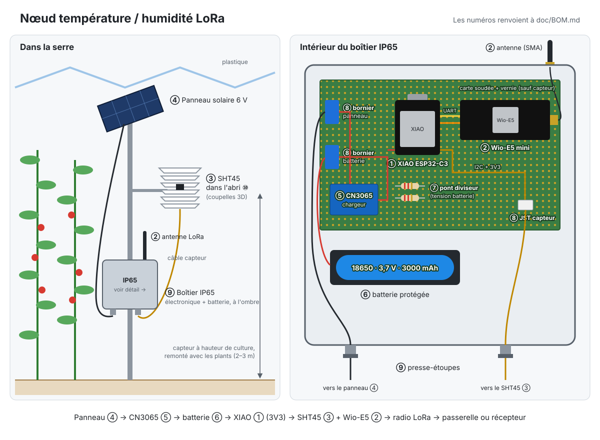

# sensor-greenhouse

Schémas matériels et firmware de nœuds capteurs environnementaux pour serre.

## Nœud température / humidité LoRaWAN — Almería

Nœud autonome (solaire + batterie) pour serres plastique type *raspa y amagado*. Dérivé du « nœud 1 » du TFG *Diseño y automatización del ecosistema de un invernadero impreso en 3D* (`doc/TFG_Maqueta_EMRE_EMIN (2).pdf`), avec un capteur plus précis, une alimentation basse consommation et le Wi-Fi remplacé par du LoRaWAN.

### BOM

Liste détaillée avec photos, noms anglais / chinois et références d'achat : [doc/BOM.md](doc/BOM.md).



| # | Composant | Qté | Prix estimé | Rôle | Link |
|---|-----------|----:|------------:|------|---|
| 1 | Seeed XIAO ESP32-C3 | 1 | NT$150 | MCU, deep sleep, régulateur 3,3 V intégré | Guanghua Electronic Plaza |
| 2 | Seeed LoRa-E5 mini (STM32WLE5JC), antenne EU868/US915 incluse | 1 | NT$700 | Radio LoRaWAN, firmware AT d'usine (EU868 / AS923…) | https://shopee.tw/%E3%80%90%E7%91%AA%E5%8F%AF%E5%B8%8C%E7%B6%AD%E3%80%91Seeed-Studio-Wio-E5-mini-STM32WLE5-%E9%96%8B%E7%99%BC%E6%9D%BF%EF%BD%9C%E7%8F%BE%E8%B2%A8%E7%99%BC%E7%A5%A8%EF%BD%9CLoRa-STM32-i.656213378.44968699955?extraParams=%7B%22display_model_id%22%3A416568324128%2C%22model_selection_logic%22%3A3%7D&image_ids=sg-11134201-82588-mtta77q1kemf34 |
| 3 | Module SHT45 avec filtre PTFE | 1 | NT$489 | Température ±0,1 °C / humidité ±1 %, heater anti-condensation | https://www.digikey.tw/zh/products/detail/adafruit-industries-llc/6174/25981346 |
| 4 | Panneau solaire 6 V 1–2 W | 1 | NT$120 | Source principale |
| 5 | Chargeur solaire CN3065 | 1 | NT$60 | Charge batterie |
| 6 | Batterie Li-ion 18650 3000 mAh protégée + support | 1 | NT$250 | Stockage énergie |
| 7 | Résistances 220 kΩ (pont diviseur) | 2 | NT$5 | Mesure tension batterie (remplace les INA219) |
| 8 | Plaque à souder + borniers / JST | 1 | NT$80 | Montage soudé = perfboard, stripboard |
| 9 | Boîtier IP65 + presse-étoupes | 1 | NT$250 | Électronique + batterie |
| 10 | Abri anti-rayonnement imprimé 3D (PETG ou ASA) | 1 | NT$30 | Protège le capteur du soleil direct |
| | **Total par nœud** | | **≈ NT$2 150** | |

À prévoir en plus :
- **Passerelle LoRaWAN EU868** (ex. Dragino LPS8N, RAK7268) : ≈ NT$4 000–5 500, partagée entre tous les nœuds (portée 1–2 km en zone de serres). Facultative si la couverture TTN est vérifiée sur site, ou si on utilise la liaison LoRa directe (voir *Option sans passerelle*).
- **Vernis de tropicalisation** : ≈ NT$300 le flacon, pour plusieurs cartes.

Prix estimés pour le marché électronique de Taipei (光華商場, 露天 / 蝦皮), à vérifier. La LoRa-E5 mini gère EU868 et AS923 : tests possibles à Taïwan, puis déploiement en Espagne en changeant seulement la région (`AT+DR=EU868`).

### Points critiques

#### 1. Condensation

En serre plastique, les nuits d'hiver montent à 95–100 % HR et l'eau condense sur le plastique et sur le capteur. Un DHT11 sature ou dérive dans ces conditions, d'où le choix du SHT45 :
- plage complète 0–100 % HR ;
- **heater intégré** : l'activer quelques secondes quand l'humidité reste bloquée vers 100 %, pour sécher le capteur, puis attendre qu'il refroidisse avant de remesurer ;
- abri ventilé (pas étanche) pour que l'air circule et que le capteur sèche au lever du jour.

#### 2. Traitements chimiques (soufre, phytosanitaires)

Les poudrages et sublimations de soufre et les pulvérisations de phytosanitaires sont fréquents. Le soufre corrode le cuivre, l'argent et les contacts, et dégrade les capteurs d'humidité non protégés. Mesures :
- **filtre PTFE** sur le capteur (protège de la poussière, des gouttes et d'une partie des polluants) ;
- carte **soudée et vernie** (vernis de tropicalisation), connecteurs dorés ou borniers, pas de breadboard ni de fils Dupont ;
- **boîtier IP65** avec presse-étoupes, seul le capteur reste à l'air dans l'abri ;
- après une campagne, contrôler la dérive du capteur par rapport à une référence.

### Câblage

| Signal | XIAO ESP32-C3 |
|--------|---------------|
| SHT45 SDA / SCL | D4 / D5 (I2C) |
| LoRa-E5 mini TX / RX | D7 (RX) / D6 (TX) — UART 9600 bauds |
| LoRa-E5 mini 3V3 / GND | 3V3 / GND |
| Pont diviseur batterie | A0 |
| Batterie (+ / −) | BAT+ / BAT− |

Alimentation : panneau → CN3065 → batterie 18650 → pads BAT du XIAO (régulateur intégré). SHT45 et LoRa-E5 mini en 3,3 V depuis la XIAO.

- **Ne pas** brancher la batterie sur l'entrée VCC de la LoRa-E5 mini : elle demande 3,7–5 V, la 18650 descend vers 3,0 V. Alimenter par la broche **3V3**.
- La LoRa-E5 mini garde son **firmware AT d'usine** : aucun code à y mettre, la XIAO la pilote par commandes AT. Reprogrammer le STM32WL efface définitivement ce firmware.
- Pendant le deep sleep de la XIAO, mettre la LoRa-E5 en `AT+LOWPOWER` sans la couper, pour garder la session LoRaWAN.

### Réseau

- LoRaWAN **EU868**, activation OTAA, payload ~6 octets (temp, hum, tension batterie).
- Envoi toutes les **5–10 min** : compatible avec le duty cycle de 1 % ; deep sleep entre deux mesures.
- Intervalle modifiable par **downlink** (remplace le topic MQTT `config/sleep` du TFG).
- Backend : TTN ou ChirpStack → MQTT → Node-RED / InfluxDB (le reste de la chaîne du TFG ne change pas).

### Option sans passerelle : liaison LoRa directe (point à point)

Pour un prototype ou une seule exploitation : pas de passerelle ni de serveur LoRaWAN. Une deuxième LoRa-E5 mini, branchée en USB sur un Raspberry Pi (ou le PC qui héberge déjà le broker du TFG), reçoit directement les messages des nœuds.

```
Nœuds (XIAO + LoRa-E5 mini) ──LoRa──► LoRa-E5 mini (USB) ──► Raspberry Pi : script Python ──► MQTT (Mosquitto) ──► Node-RED / InfluxDB
```

**Matériel en plus (station de réception, une seule pour tous les nœuds)** :

| # | English | 中文（台灣） | Qté | Prix | Remarque |
|---|---------|--------------|----:|-----:|----------|
| R1 | Seeed Studio Wio-E5 mini (antenne EU868/US915 + câble USB-C inclus) | Wio-E5 mini LoRaWAN 開發板 | 1 | NT$765 ¹ | Même carte que sur les nœuds, garde son firmware AT |
| R2 | Raspberry Pi 4 Model B, 2 GB | 樹莓派 4 Model B 2GB | 1 | ≈ NT$1 600 | Fait tourner récepteur + Mosquitto + Node-RED + InfluxDB. Inutile si un PC allumé en permanence fait déjà broker |
| R3 | Official Raspberry Pi USB-C power supply 5 V 3 A | 樹莓派 4 官方電源供應器 5V 3A | 1 | ≈ NT$300 | Un chargeur de téléphone fait souvent chuter la tension |
| R4 | microSD card 32 GB, A1 / Class 10 | microSD 記憶卡 32GB A1 | 1 | ≈ NT$200 | Raspberry Pi OS Lite |
| R5 | Raspberry Pi 4 case | 樹莓派 4 外殼 | 1 | ≈ NT$150 | — |
| R6 | SMA extension cable, 1–3 m (optionnel) | SMA 延長線 公對母 1–3m | 1 | ≈ NT$150 | Pour placer l'antenne en hauteur, au-dessus des cultures |
| | | | | **≈ NT$3 150** | **≈ NT$765** avec un PC existant |

¹ Prix relevé sur Shopee (octobre 2026). Les autres sont estimés, à vérifier.

Pour la réception seule (le broker et Node-RED restent sur un autre PC), un **Raspberry Pi Zero 2 W** (樹莓派 Zero 2 W, ≈ NT$650) suffit, avec un adaptateur USB-C → micro-USB OTG (OTG 轉接頭).

**Compromis** : pas de chiffrement, pas d'adaptation automatique du débit, pas de réseau public, collisions possibles entre nœuds. Acceptable pour un prototype.

#### 1. Paramètres radio (identiques sur tous les modules)

Les deux côtés passent la LoRa-E5 en mode test (`AT+MODE=TEST`) avec la même configuration :

```
AT+TEST=RFCFG,868.1,SF7,125,12,15,14,ON,OFF,OFF
```

Fréquence (MHz), facteur d'étalement, bande passante (kHz), préambules TX/RX, puissance (dBm), CRC, inversion IQ, sync word LoRaWAN public.

- **Espagne** : 868.1 MHz, 14 dBm max (sous-bande 868,0–868,6 MHz, duty cycle 1 %).
- **Tests à Taïwan** : utiliser une fréquence de la bande 920–925 MHz (ex. 923.2).
- **Portée** : commencer en SF7 ; passer en SF9–SF10 si les messages n'arrivent pas (plus lent, mais toujours largement sous le 1 % avec un envoi toutes les 10 min).

#### 2. Message envoyé (7 octets)

| Octets | Contenu |
|--------|---------|
| 0 | ID du nœud (1 à 255) |
| 1–2 | Température × 10 (signé) |
| 3–4 | Humidité × 10 |
| 5–6 | Tension batterie (mV) |

L'ID est indispensable : sans LoRaWAN, rien d'autre n'identifie l'émetteur.

#### 3. Firmware du nœud (XIAO)

Même programme qu'en LoRaWAN, en remplaçant la partie join / `AT+MSGHEX` par :

```cpp
#define NODE_ID 1                            // unique pour chaque nœud

at("AT+MODE=TEST", "TEST", 1000);
at("AT+TEST=RFCFG,868.1,SF7,125,12,15,14,ON,OFF,OFF", "RFCFG", 1000);
snprintf(cmd, sizeof cmd, "AT+TEST=TXLRPKT,\"%02X%04X%04X%04X\"",
         NODE_ID, (uint16_t)t, h, mv);
at(cmd, "TX DONE", 3000);

at("AT+LOWPOWER", "SLEEP", 1000);
// intervalle + 0–30 s aléatoires pour limiter les collisions entre nœuds
esp_sleep_enable_timer_wakeup((INTERVAL_S + random(0, 30)) * 1000000ULL);
esp_deep_sleep_start();
```

#### 4. Récepteur (Raspberry Pi)

```bash
sudo apt install mosquitto python3-serial python3-paho-mqtt
```

`recepteur.py` :

```python
import re
import serial
import paho.mqtt.publish as publish

PORT = "/dev/ttyUSB0"          # Windows : "COM5"
BROKER = "localhost"
RFCFG = "AT+TEST=RFCFG,868.1,SF7,125,12,15,14,ON,OFF,OFF"

ser = serial.Serial(PORT, 9600, timeout=1)
for cmd in ("AT+MODE=TEST", RFCFG, "AT+TEST=RXLRPKT"):   # RXLRPKT : réception continue
    ser.write((cmd + "\r\n").encode())
    print(ser.readline().decode(errors="ignore").strip())

rssi = None
while True:
    line = ser.readline().decode(errors="ignore").strip()
    if m := re.search(r"RSSI:(-?\d+)", line):
        rssi = int(m.group(1))
        continue
    m = re.search(r'RX "([0-9A-Fa-f]+)"', line)
    if not m:
        continue
    b = bytes.fromhex(m.group(1))
    if len(b) != 7:
        continue
    base = f"invernadero/nodo{b[0]}"
    publish.multiple([
        (f"{base}/temperatura", int.from_bytes(b[1:3], "big", signed=True) / 10),
        (f"{base}/humedad", int.from_bytes(b[3:5], "big") / 10),
        (f"{base}/bateria_mv", int.from_bytes(b[5:7], "big")),
        (f"{base}/rssi", rssi),
    ], hostname=BROKER)
```

Lancer avec `python3 recepteur.py`, puis en faire un service systemd pour qu'il démarre avec le Raspberry Pi.

#### 5. Node-RED

Un nœud *MQTT In* abonné à `invernadero/+/+` → InfluxDB, comme dans le TFG. Le RSSI permet de surveiller la qualité de liaison de chaque nœud.

Les extraits de code ci-dessus n'ont pas encore été testés sur le matériel.

### Contraintes terrain (Almería)

- **Condensation** et **traitements chimiques** : voir *Points critiques* ci-dessus.
- **Rayonnement** : capteur toujours dans l'abri, à hauteur de culture, sur un support réglable (tomate / poivron jusqu'à 2–3 m).
- **Chaleur** : batterie dans le boîtier, à l'ombre et hors de l'abri capteur. Pas de charge Li-ion au-delà de 45 °C. Imprimer en PETG ou ASA (le PLA se déforme vers 55 °C).
- **Poussière** : nettoyer le panneau et le filtre en cours de campagne.
- **Objectif** : tenir une campagne complète (septembre → juin) sans intervention.
