# BOM — nœud température / humidité LoRa

Liste des pièces d'un nœud, avec les noms en anglais et en chinois traditionnel (Taïwan) pour la recherche sur Shopee, 露天, DigiKey ou au 光華商場.

| # | Photo | English | 中文（台灣） | Qté | Prix | Où / référence |
|---|-------|---------|--------------|----:|-----:|----------------|
| 1 | 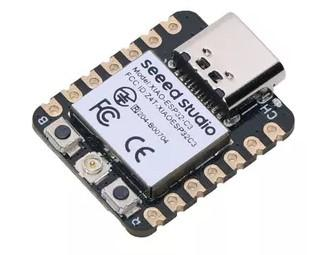 | Seeed Studio XIAO ESP32-C3 | XIAO ESP32-C3 開發板 | 1 | NT$203 ¹ | [Shopee](https://shopee.tw/product/656213378/50604383285), option « Have Welding » (排針已焊接) |
| 2 | 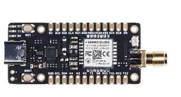 | Seeed Studio Wio-E5 mini (ex-LoRa-E5 mini, STM32WLE5JC), antenne EU868/US915 incluse | Wio-E5 mini LoRaWAN 開發板（STM32WLE5JC） | 1 | NT$765 ¹ | [Shopee](https://shopee.tw/product/10207300/17538315042) |
| 3 | 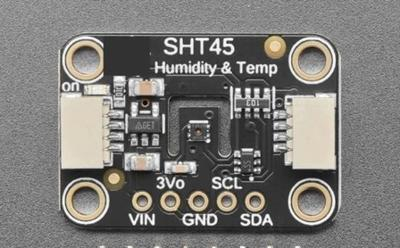 | Adafruit SHT45 Temperature & Humidity Sensor **with PTFE** (puce SHT45-AD1F) | SHT45 溫濕度感測器模組（含 PTFE 濾膜） | 1 | NT$489 ¹ | DigiKey `1528-6174-ND` (Adafruit **6174**). ⚠️ Adafruit 5665 = version **sans** filtre |
| 4 | 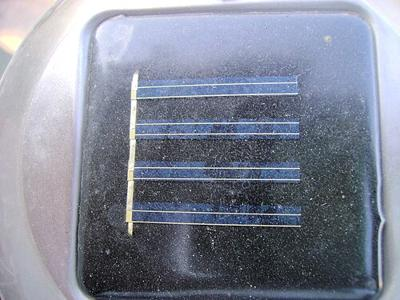 | 6 V 1–2 W monocrystalline solar panel (laminated) | 6V 1–2W 單晶矽太陽能板（層壓） | 1 | NT$120 | Vérifier la tension à vide (開路電壓) vs l'entrée max du CN3065 |
| 5 | — | CN3065 solar Li-ion charger module | CN3065 太陽能鋰電池充電模組 | 1 | NT$60 | Existe en kit avec le panneau |
| 6 | 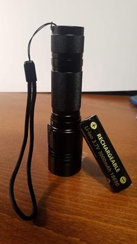 | 18650 Li-ion battery 3000 mAh, protected + holder | 18650 鋰電池 3000mAh（含保護板）＋ 電池盒 | 1 | NT$250 | Prendre une cellule **protégée** (保護板) |
| 7 | 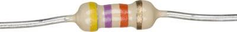 | 220 kΩ resistor | 220kΩ 電阻 | 2 | NT$5 | Pont diviseur tension batterie |
| 8a | 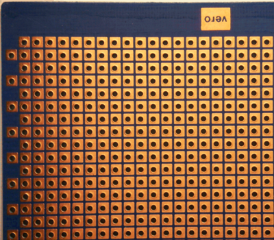 | Double-sided FR4 perfboard, 5 × 7 cm | 雙面萬用板（洞洞板）5×7 cm, FR4 | 1 | NT$30 | Pas de bakélite marron |
| 8b | 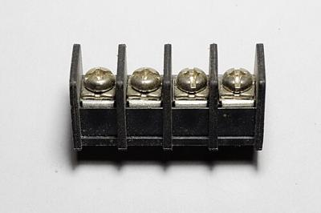 | PCB screw terminal block, 5.08 mm (KF301) | 接線端子 KF301 5.08mm | 2 | NT$20 | Panneau + batterie |
| 8c | — | JST-PH 2.0 connector with wires | JST-PH 2.0 端子線 | 1 | NT$30 | Câble du capteur |
| 9 | 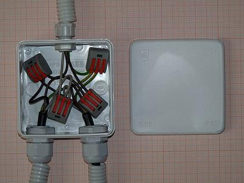 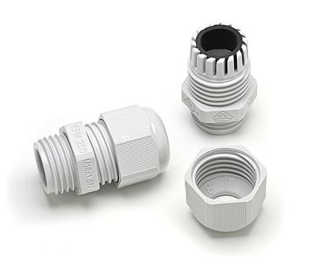 | IP65 enclosure + cable glands | IP65 防水接線盒 ＋ 防水接頭（電纜固定頭） | 1 | NT$250 | Électronique + batterie |
| 10 | 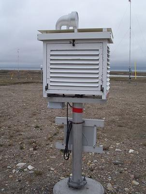 | Radiation shield, 3D printed (PETG / ASA) | 防輻射罩（百葉箱），3D 列印 PETG / ASA | 1 | NT$30 | Photo : principe (abri Stevenson). Version imprimée = coupelles empilées |
| | | | | | **≈ NT$2 250** | |

¹ Prix relevé sur l'annonce (octobre 2026). Les autres prix sont des estimations, à vérifier.

### À prévoir en plus

| English | 中文（台灣） | Prix | Remarque |
|---------|--------------|-----:|----------|
| Conformal coating | 電路板防潮漆（三防漆） | ≈ NT$300 | Pour plusieurs cartes. Masquer le capteur |
| LoRaWAN gateway EU868 | LoRaWAN 閘道器 | ≈ NT$4 000–5 500 | Inutile en liaison LoRa directe (voir README) |
| 2nd Wio-E5 mini (receiver, P2P mode) | 第二片 Wio-E5 mini（接收端） | NT$765 | Uniquement pour l'option sans passerelle |

### Crédits photos

- 1–3 : photos produit Seeed Studio / Adafruit (annonces Shopee), usage illustratif.
- [18650](https://commons.wikimedia.org/wiki/File:18650_battery,_3000mAh,_new_in_2024.jpg) (N2e, CC0) · [résistances](https://commons.wikimedia.org/wiki/File:Electronic_Axial_Lead_Resistors_47kOhm.jpg) (Evan-Amos, CC0) · [bornier](https://commons.wikimedia.org/wiki/File:Screw-type_terminal_block,_10mm_spacing_01.jpg) (Retired electrician, CC0) · [abri Stevenson](https://commons.wikimedia.org/wiki/File:Stevenson_screen_exterior.JPG) (domaine public)
- [Perfboard](https://commons.wikimedia.org/wiki/File:CopperCladPerfboard_1.png) (Klaus-Günter Leiss, CC BY-SA 3.0) · [boîtier IP65](https://commons.wikimedia.org/wiki/File:IP65_junction_box.JPG) (Dmitry G, CC BY-SA 3.0) · [presse-étoupe](https://commons.wikimedia.org/wiki/File:M16_cable_gland.jpg) (Phiarc, CC BY-SA 4.0) · [panneau solaire](https://commons.wikimedia.org/wiki/File:Solar_garden_Lights_top.jpg) (Yousaf465, CC BY 3.0)
